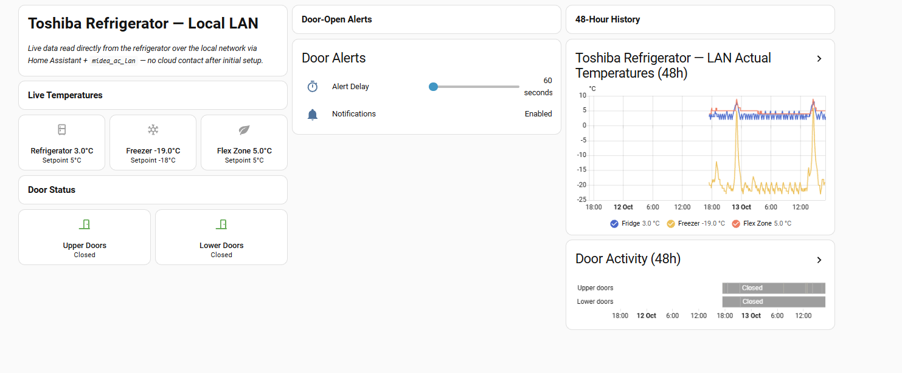

# toshiba-tsmartlife-local

**A Home Assistant monitoring solution for Toshiba refrigerators paired to
the TSmartLife app** — real refrigerator/freezer/flex-zone temperatures,
door status, and history, running on your own home network.

> ## ⚠ DEVELOPER PREVIEW
> This is an early, unofficial, independent project — not a finished
> product, not an official release, and **not affiliated with, endorsed
> by, or supported by Toshiba or Midea** in any way. Verified end-to-end
> against exactly one physical unit so far (see
> [Supported Toshiba models](#supported-toshiba-models)); no independent
> third-party installation has been confirmed yet. It uses the existing
> open-source [`midea_ac_lan`](https://github.com/wuwentao/midea_ac_lan)
> Home Assistant integration for all actual device communication — this
> project only gets that integration the one piece of information it
> needs for a TSmartLife-paired appliance.

## What this project does

Your Toshiba fridge already talks to Toshiba's cloud through the
TSmartLife app. This project is a small, one-time setup step that lets
**Home Assistant talk to your fridge directly, over your own local
network** — no phone app needed afterward, no repeated cloud calls, and
your temperature/door data becomes a normal part of your smart home
(history graphs, automations, notifications) instead of being stuck
inside a separate app.

It does this by reusing two already-public, independently maintained
open-source projects rather than reinventing anything:
[`midea_ac_lan`](https://github.com/wuwentao/midea_ac_lan) (the Home
Assistant integration that actually talks to the fridge over LAN) and
[`midea-lan`](https://github.com/wuwentao/midea-lan) (the underlying
protocol/cloud library). This project's own code is just the missing
piece between them: a small CLI that logs into *your* TSmartLife account
*once*, and hands you the one-time local-network key your fridge's
`midea_ac_lan` entry needs. See [Architecture](docs/ARCHITECTURE.md) if
you're curious why it's built this way instead of as a new app/integration.

### TSmartLife app vs. this project — what's actually different

| | TSmartLife app | This project (via Home Assistant) |
|---|---|---|
| Where data comes from | Toshiba's cloud, every time you open the app | Your own LAN, directly from the fridge |
| Works without internet | No | Yes, after the one-time setup below |
| History/graphs | Not built in | Native Home Assistant history, any time range |
| Automations (e.g. door-left-open alerts) | Not available | Yes, confirmed working — see [below](#optional-door-open-alert-blueprint) |
| Combine with other sensors/dashboards | No | Yes, it's just more Home Assistant entities |
| Ongoing cloud dependency | Every use | None, once set up |

**Why this is worth the one-time setup**: the app typically shows you what
the fridge is *set to*, not necessarily what it's *actually* doing right
now at a glance — you'd have to open the app and check manually, every
time. An actual-temperature reading in Home Assistant means you can see
at a glance whether the compartment is really holding its target (useful
if a door seal is failing, or during a power outage), graph it over days
or weeks, and get notified automatically the moment a door's been left
open — rather than finding out only when you happen to check.

## What you gain

Once set up, you get these as normal Home Assistant entities, usable in
any dashboard, automation, or notification:

- Read the **actual** refrigerator temperature (not just the setpoint).
- Read the **actual** freezer temperature.
- Read the **actual** flex-zone temperature.
- Compare actual temperatures against their target settings at a glance.
- Monitor upper-door and lower-door open/closed status.
- Record and graph temperature history over any time range Home Assistant
  keeps.
- Create an adjustable door-left-open notification — **confirmed
  working**, delay is yours to tune (see the blueprint below).
- All of the above over your **local network only**, after one initial
  cloud login — see the one caveat below before you run anything.

> **⚠ One-time caveat, know this in advance**: getting your fridge's local
> key requires logging into TSmartLife once, with your own account. This
> is known to momentarily sign the official TSmartLife phone app out —
> harmless, temporary, but better to expect it than be surprised by it.
> Full detail: [Quick installation](#quick-installation) below and
> [`docs/SECURITY_AND_PRIVACY.md`](docs/SECURITY_AND_PRIVACY.md).

## Screenshots / example dashboard



*A real Home Assistant dashboard, showing live data from the actual
tested unit (Toshiba `GR-RF900WI-PMV(06)-MG`, Vietnam) over the local
network — not a mockup. This particular layout is just one example: the
cards, which sensors are shown, and whether history/door-alerts are
included are all yours to customize — see
[`examples/lovelace_dashboard_example.yaml`](examples/lovelace_dashboard_example.yaml),
a complete, ready-to-paste Lovelace view (standard Home Assistant cards
only, no custom/HACS cards needed) demonstrating the same entities, where
every card is independent so you can include only the parts you want:*

- An **entities card** with all three actual temperatures and their
  setpoints side by side.
- A **glance card** for upper/lower door status.
- A **48-hour history graph** of all three actual temperatures.
- An optional **entities card** for the door-left-open alert's delay
  setting, once you've added the blueprint below.

It's intentionally compact — small cards, readable on a phone screen
without scrolling sideways. Substitute `YOUR_DEVICE_ID` with your own
appliance's numeric ID (visible in each entity's own entity_id once
you've completed setup).

## Supported Toshiba models

Verified end-to-end against exactly one physical unit so far:

| | |
|---|---|
| Model | Toshiba `GR-RF900WI-PMV(06)-MG` |
| Market | Vietnam |
| App | TSmartLife ("oversea" variant) |
| Midea device type | `0xCA` (refrigerator) |
| Protocol | LAN V3 |
| Internal model code | `310A079W` |

**Do not assume other Toshiba models, other markets, or other Midea-family
apps work identically.** The underlying device-type/protocol family
(`0xCA`) is shared across many Midea-made refrigerators sold under
different brands, so this *may* generalize — but only this one
model/app/market combination has actually been tested, and no independent
third party has installed this yet either. If you try this on a different
model, please [report back](#contributing--testing-another-model) either
way (worked or didn't) — that's genuinely useful information this project
doesn't have yet.

## Quick installation

```bash
pip install -e .
toshiba-tsmartlife-onboard
```

That's the whole command sequence for the Vietnam/TSmartLife variant
above — the 4 shared app-level constants this needs are already built in
(see [`docs/APP_CREDENTIAL_SECURITY.md`](docs/APP_CREDENTIAL_SECURITY.md)),
and `pip install -e .` alone pulls in its one real dependency
automatically. The CLI prompts for your TSmartLife email and password
(password hidden, never stored), logs in once, and prints the `token`/
`key` pair you paste into `midea_ac_lan`'s "Configure manually" step.

> **⚠ Know this before you run it**: a fresh cloud login is known to
> momentarily displace the official TSmartLife app's own session on your
> phone — harmless and temporary, but expect it rather than be surprised.

Two things worth knowing about the one dependency this pulls in: it's not
on PyPI under that name yet (hence the GitHub-URL pin), and it currently
points at **our own fork's branch**, not upstream directly — the
TSmartLife cloud support this needs is still an open, unmerged upstream PR
([#198](https://github.com/wuwentao/midea-lan/pull/198)). Full
explanation: [`NOTICE.md`](NOTICE.md).

## Detailed installation guide

**For a full, plain-language, step-by-step walkthrough — installing
Python itself on Windows/macOS/Linux, creating a virtual environment,
installing `midea_ac_lan` in Home Assistant, choosing which entities to
enable, and adding the example dashboard and door-open alert — see
[`docs/USER_GUIDE.md`](docs/USER_GUIDE.md).** Each step there is marked
tested/untested/blocked/confirmed-working, not just described. In short,
the whole flow is: install the CLI → log in once to TSmartLife → pick
your appliance → get its LAN token/key → connect it in `midea_ac_lan` →
pick which entities to enable → add the optional dashboard and door
alerts.

## Troubleshooting

Quick answers to the 3 most common snags — full list with more detail in
[`docs/TROUBLESHOOTING.md`](docs/TROUBLESHOOTING.md):

- **"TSmartLife cloud login failed"** — double-check your email/password
  first (confirm they still work in the official app), then double-check
  any app-constant overrides you've set have no extra whitespace.
- **"No appliance with SN ... found on this account"** — the serial
  number must match exactly what the TSmartLife app's Device Information
  screen shows, and you must be logging in with the same account that
  device is paired to.
- **It worked, but `midea_ac_lan` still won't connect** — confirm you
  used "Configure manually" with device type `0xCA`/protocol `V3`, and
  that your fridge and Home Assistant are reachable on the same local
  network/VLAN (IoT-segmented VLANs that block east-west traffic look
  identical to a bad token).

## Available HA entities

Once `midea_ac_lan` is configured with your fridge's LAN token/key (see
the guide above) and you've enabled these in its **Options** step, these
are confirmed working against the one tested unit:

| Entity | What it shows |
|---|---|
| `sensor.<device_id>_refrigerator_actual_temp` | Real refrigerator compartment temperature |
| `sensor.<device_id>_refrigerator_setting_temp` | Refrigerator setpoint |
| `sensor.<device_id>_freezer_actual_temp` | Real freezer compartment temperature |
| `sensor.<device_id>_freezer_setting_temp` | Freezer setpoint |
| `sensor.<device_id>_flex_zone_actual_temp` | Real flex-zone compartment temperature |
| `sensor.<device_id>_flex_zone_setting_temp` | Flex-zone setpoint |
| `binary_sensor.<device_id>_refrigerator_door` | Upper-door group: open/closed |
| `binary_sensor.<device_id>_freezer_door` | Lower-door group: open/closed |

Everything else in `midea_ac_lan`'s generic entity table for this device
type is either confirmed not meaningful on this model, or simply
untested — see [Limitations](#limitations) before enabling anything else.

## Optional door-open alert blueprint

[`examples/blueprints/door_left_open_alert.yaml`](examples/blueprints/door_left_open_alert.yaml)
is a ready-to-import Home Assistant automation blueprint: notifies you
when a door group (upper or lower) stays open longer than a delay *you*
set via a simple number helper — one alert per continuous opening, no
editing the automation itself to change the delay later. **This pattern
is confirmed working**, not an unverified idea — see
[`docs/USER_GUIDE.md`](docs/USER_GUIDE.md) step 7a for the exact import
steps.

Import it via **Settings → Automations & Scenes → Blueprints → Import
Blueprint**, pasting the raw file URL (or copy it manually into
`config/blueprints/automation/`). You'll need a number helper for the
delay first (**Settings → Devices & Services → Helpers → Number**) — the
blueprint's own import screen explains exactly what it needs.

## Contributing / testing another model

Running this successfully (or unsuccessfully) against a different
Toshiba model, market, or appliance is genuinely useful to report — see
[`CONTRIBUTING.md`](CONTRIBUTING.md) for exactly what to include, how to
redact personal identifiers before posting, how to report sensor fields
that don't work, and where a fix actually belongs (this project vs.
upstream `midea-lan`/`midea_ac_lan`).

## Limitations

- **Humidity** doesn't work on the tested unit — it's architecturally a
  control-mode flag, not a %RH sensor. Full root cause:
  [`docs/KNOWN_LIMITATIONS.md`](docs/KNOWN_LIMITATIONS.md).
- **Only two door groups** (upper, lower) have ever been confirmed to
  report a real state on this unit, not four individually-addressable
  doors.
- **No instantaneous power/wattage** from the Toshiba LAN protocol itself
  — pair an independent smart plug if you want that.
- This project doesn't claim support for any other Toshiba model, market,
  or Midea-family rebrand — see [Supported Toshiba models](#supported-toshiba-models).
  No independent third-party installation has been confirmed yet, which
  is why this remains a Developer Preview.
- The initial setup needs one cloud login with your own account (see the
  caveat under [What you gain](#what-you-gain)) — monitoring afterward is
  fully local.

## Credits to upstream Midea projects

This project depends on, but does not fork or copy,
[`midea-lan`](https://github.com/wuwentao/midea-lan) (MIT, © 2026 Wentao
Wu, © 2021 George Zhao), and recommends
[`midea_ac_lan`](https://github.com/wuwentao/midea_ac_lan) for the actual
Home Assistant integration — both already-public, independently
maintained projects this one builds on top of, not around. Full
attribution: [`NOTICE.md`](NOTICE.md). License: MIT, see [`LICENSE`](LICENSE).

## Further documentation

- [`docs/USER_GUIDE.md`](docs/USER_GUIDE.md) — full step-by-step walkthrough
- [`docs/ARCHITECTURE.md`](docs/ARCHITECTURE.md) — why this project is scoped the way it is
- [`docs/APP_CREDENTIAL_SECURITY.md`](docs/APP_CREDENTIAL_SECURITY.md) — security/redistribution analysis of the 4 app-level constants
- [`docs/TOKEN_ONBOARDING.md`](docs/TOKEN_ONBOARDING.md) — the real onboarding story, blockers included
- [`docs/SECURITY_AND_PRIVACY.md`](docs/SECURITY_AND_PRIVACY.md)
- [`docs/TROUBLESHOOTING.md`](docs/TROUBLESHOOTING.md)
- [`docs/DEVELOPER_GUIDE.md`](docs/DEVELOPER_GUIDE.md) — adding another model/market
- [`docs/KNOWN_LIMITATIONS.md`](docs/KNOWN_LIMITATIONS.md)
- [`examples/`](examples/) — generic Home Assistant config + dashboard YAML (no personal device IDs)
